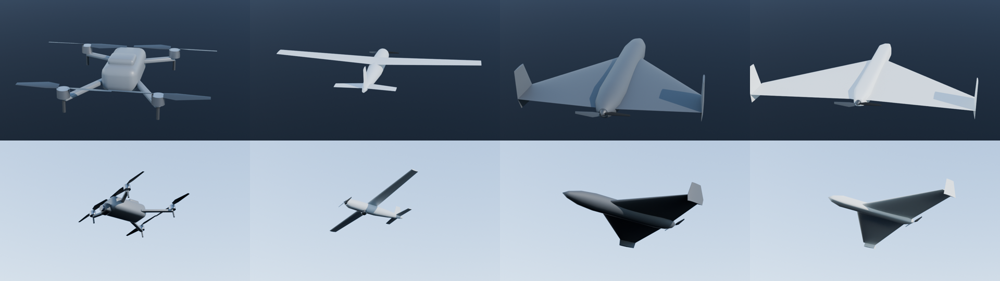

# Mirror World

A synthetic scenario generator for aerial objects over real terrain in Ukraine. You give it a scenario file. It gives back the truth (where each drone was) and the data that each sensor recorded (radio receivers, radar, daylight and thermal cameras, microphone arrays, Remote ID), on one shared clock.

A single LLM prompt can produce numbers that look correct. This engine computes every value from the terrain and the physics of each sensor, so you can explain every record. Click a sensor row in the viewer to see the full breakdown for that moment.

The drones fly a kinematic flight model with each type's real limits (speed, acceleration, climb, tilt or bank), so they brake, lean and bank through turns. The viewer shows each one as a 3D model with that attitude.



## Run

```bash
uv venv && uv pip install -r requirements.txt    # or: pip install -r requirements.txt
.venv/bin/python serve.py                        # then open http://localhost:8765/viewer/
.venv/bin/python test_sim.py                     # faithfulness checks
.venv/bin/python sim.py                          # optional: scenario.json -> out/, no viewer
```

1. Choose one of the 4 areas.
2. Set the number of receivers and drones. The engine runs again (in a few seconds) and puts them at random positions.
3. Click **New layout** to get a new seed and new positions.

The first visit to an area downloads part of one Copernicus GLO-30 tile from public S3 (no key). The engine keeps it in `.cache/`.

The URL always holds the current layout, so you can share it. Example: `viewer/?area=kaniv&rx=3&dr=2&seed=42&t=450&ground=map&sel=RF2|drone_01`. The parameters are:
- `area`: the area id from `areas.json`
- `rx`, `dr`: the number of receivers and drones
- `seed`: the random seed
- `t`: the time in seconds
- `ground`: `sat`, `map` or `elev`
- `show`: `truth`, `sensed` or `both`
- `sel`: a sensor|object pair

## Files

| File | What it does |
|---|---|
| `areas.json` | The example areas. To add an area, add a line. The box must stay inside one 1° tile |
| `scenario.json` | A hand-written example scenario for `sim.py`, with one sensor of each type |
| `sim.py` | Engine: random layout → DEM → truth → sensor links → fixes → outputs |
| `serve.py` | Serves the viewer and runs the engine for each request |
| `flight.py` | Flight model: drone type + flight plan → 10 Hz track with heading, pitch and roll |
| `drones.json` | Drone types: size, mass, endurance, flight limits, radar, heat and sound signature, 3D model |
| `models/` | One GLB model per drone type, plus the Blender scripts that build and render them |
| `models/sensors/` | One GLB model per sensor type, built by `models/build_sensors.py` (standard library only) |
| `test_sim.py` | Checks that the physics behaves as it should |
| `viewer/index.html` | 3D replay. One file, libraries come from a CDN, no build step |

## Random layout

- Receivers go on high ground (the top 25% of the inner box). Each new receiver takes the position farthest from the receivers that are already placed.
- Each drone gets a random type from `drones.json`:
  - `quadcopter` (50%): 60–120 m above ground, 2.4 GHz
  - `fixed_wing_recon` (25%), `delta_wing` (15%), `decoy` (10%): 200–400 m above ground, 5.8 GHz
- Each drone flies a loop of 3–5 random waypoints at the cruise speed of its type. Quadcopters broadcast Remote ID; the others do not.
- Each layout also gets one radar, one daylight camera and one thermal camera on high ground, and one microphone array and one Remote ID receiver anywhere in the inner box.
- Each sensor and drone has its own random stream from `(seed, kind, index)`. When you add a receiver or a drone, nothing else moves.

## Drones

Each object's `type` is a key in `drones.json`:

| Type | Class | Size | Cruise (max) | Turns by |
|---|---|---|---|---|
| `quadcopter` | DJI Mavic 3 | 0.35 m, 0.9 kg | 12 m/s (21) | tilting up to 35°, can hover and land |
| `fixed_wing_recon` | Orlan-10 | 3.1 m span, 18 kg | 30 m/s (42) | banking up to 30° |
| `delta_wing` | Shahed-136 / Geran-2 | 2.5 m span, 200 kg | 51 m/s (56) | banking up to 30° |
| `decoy` | Gerbera | 2.4 m span, 18 kg | 42 m/s (47) | banking up to 30°; rough figures |

The figures are rounded public numbers for the class, not the spec sheet of one airframe.

A drone starts at `waypoints[0]`, at `alt_agl_m` and `speed_ms`, and flies to each further waypoint (`loop` repeats them). For other trajectories, give a `plan` instead of more waypoints, as a list of legs:

```json
"plan": [{"orbit": {"lat": 49.75, "lon": 31.50, "radius_m": 800, "duration_s": 600, "direction": "ccw"}},
         {"goto": {"lat": 49.70, "lon": 31.45, "alt_m": 120, "speed_mps": 15}},
         {"hover": {"duration_s": 120}}, {"land": {}}]
```

| Leg | Fields | What it does |
|---|---|---|
| `takeoff` | `alt_m` | climbs to that height above ground |
| `goto` | `lat`, `lon`, opt. `alt_m`, `speed_mps` | flies to a point; a multirotor brakes to a stop unless another `goto` follows |
| `orbit` | `lat`, `lon`, `radius_m`, `duration_s`, opt. `direction` (`cw`/`ccw`), `alt_m`, `speed_mps` | flies to the circle and circles it; refuses a radius too tight for the drone |
| `hover` | `duration_s` | multirotor only |
| `land` | none | multirotor only |

When the plan ends before the scenario does, a multirotor hovers and a fixed-wing circles its last point. An optional top-level `"wind": {"from_deg": 270, "speed_mps": 10}` makes fixed-wing drones crab and change speed over the ground, and makes a multirotor lean into the wind.

The models are at real size in metres, nose −Z, right +X, up +Y (glTF axes), with the propellers as separate `prop_*` objects. The viewer draws them 44 px across at any zoom, and paints each one in its path colour. To rebuild them or render one as a camera would see it (attitude from a `truth.csv` row):

```bash
blender -b -P models/build.py
blender -b -P models/render.py -- models/delta_wing.glb frame.png --heading 250 --roll 12 --distance 300 --cam-el 20 --fov 3
```

## Outputs (`out/<area>/`)

| File | Contents | Who sees it |
|---|---|---|
| `truth.csv` | Position, altitude, speed, heading, pitch and roll of each object, every second | Answer key |
| `rf_raw.csv` | What each receiver reports: power, SNR, bearing. Detections only | Sensor data |
| `rf_budget.csv` | Full link budget for every receiver, object and second, detected or not | Explanation |
| `radar_raw.csv` | What the radar reports: range, bearing, radial velocity, SNR. Detections only | Sensor data |
| `radar_budget.csv` | Full two-way link budget for every radar, object and second, detected or not | Explanation |
| `camera_raw.csv` | What each camera reports: azimuth, elevation, class and confidence. Detections only | Sensor data |
| `camera_budget.csv` | Line of sight, pixels on target, contrast or heat left, margin, sun elevation, every second | Explanation |
| `acoustic_raw.csv` | What each microphone array reports: sound level, SNR, bearing. Detections only | Sensor data |
| `acoustic_budget.csv` | Sound travel time, spreading, absorption, terrain, noise and SNR, every second | Explanation |
| `remote_id_raw.csv` | Decoded Remote ID messages: ID, reported position, altitude, speed, operator position | Sensor data |
| `remote_id_budget.csv` | Link budget of the Remote ID broadcast, every second | Explanation |
| `fused.cot.xml` | Positions from crossed bearings, a radar's range + bearing, or a Remote ID message, as TAK Cursor on Target events | Sensor data |
| `fused.csv` | The same fixes, with `source_object_id`, `method` and the error against the truth | Answer key |
| `bundle.json` | Everything the viewer needs | Viewer |

Every sensor record has a `source_object_id` column. All files use the same UTC clock.

## Radio model

For each receiver, each drone and each second:

1. Sample the terrain on the straight line between the receiver and the drone. Add the earth bulge (k = 4/3).
2. Calculate the free-space path loss.
3. Find the worst obstacle and calculate its knife-edge diffraction loss (ITU-R P.526).
4. Add log-normal shadowing. The shadowing changes slowly over time (AR(1)), so it does not jump at random each second.
5. Received power = EIRP + antenna gain − losses. SNR = power − noise floor. Detected if SNR ≥ threshold.
6. Bearing = true bearing + fixed receiver bias + noise. The noise grows as the SNR drops.

When two or more receivers detect the same drone, a weighted least-squares crossing gives a position. `ce` comes from the covariance of that solution.

## Radar model

A radar is active: it transmits on its own frequency and hears its own echo, so it detects a drone whether or not that
drone is transmitting. For each radar, each drone and each second:

1. Run the same terrain-and-diffraction path loss as the radio model, once, since the radar sits at both ends of the link.
2. Double it (the signal crosses that path twice, out and back) and add the target's reflected aperture, from its
   radar cross-section (`rcs_dbsm` in `drones.json`) and the radar's wavelength.
3. Add the gain from integrating many pulses over a dwell (`integration_gain_db`) — a single pulse at this power would
   rarely detect anything.
4. Received power = transmit power + antenna gain (×2, the same antenna sends and listens) − losses + RCS gain +
   integration gain. SNR = power − noise floor. Detected if SNR ≥ threshold.
5. Bearing = true bearing + fixed bias + noise, same as a receiver. Range and radial velocity (Doppler) get their own
   noise, also growing as the SNR drops.

One radar already gives a full fix (range + bearing), no crossing with a second sensor needed.

## Camera model

Daylight (`"band": "visible"`) and thermal (`"band": "thermal"`) cameras on a pan-tilt head. For each camera, drone and second:

1. Sample the terrain under the sight line. If the terrain rises above it, the drone is hidden.
2. Pixels on the drone = its largest dimension / (range × the angle of one pixel). Below one pixel, the drone is smeared and its signal drops with the square of the fraction it covers.
3. Daylight: the contrast left after the air is `target_contrast × e^(−3.912 × range / visibility)` (Koschmieder). It needs the sun above −6° (civil twilight); the engine computes the sun's elevation for the area and time.
4. Thermal: the temperature difference left is `thermal_dt_k` (in `drones.json`) × `e^(−extinction × range)`. It needs `snr_required × netd_k`. It works day and night.
5. Margin = the smaller of 20 log(pixels / `px_detect`) and 20 log(signal / signal needed), minus a slowly drifting atmospheric shimmer. Detected if the margin ≥ threshold and the sight line is clear.
6. It reports azimuth and elevation (precise: 0.1–0.15°) and a class (multirotor or fixed wing). The confidence comes from the Johnson curve with `px_recognise` pixels at 50%.

## Acoustic model

A microphone array hears engines and propellers (`spl_1m_db` in `drones.json`). Sound needs range / 343 s to arrive, so the array hears the drone where it was then. The bearing points there, a few hundred metres behind a fast drone.

Level = sound at 1 m − 20 log(range) − air absorption − terrain diffraction (the same knife-edge maths as radio, with the sound's wavelength) − turbulence. SNR = level + array and processing gain − background noise (ambient plus wind on the microphones). Bearing noise grows as the SNR drops.

## Remote ID model

A cooperative drone (`"remote_id": true`) broadcasts its own position, altitude, speed and operator position once a second. The link uses the radio model at 2.4 GHz with a 14 dBm broadcast. When the receiver decodes it, the reported position (with a few metres of drifting GNSS error) is a fix on its own.

## Fusion

Every sensor that measures a bearing (radio receivers, cameras, microphone arrays) joins the same weighted crossing, so cameras and microphones can locate a drone that does not transmit. A radar detection or a Remote ID message is a fix by itself. The viewer shows one fix per drone per second: Remote ID first, then radar, then the crossing.

## Checks (`test_sim.py`)

- On flat ground, the loss always increases with distance.
- A 150 m ridge between the receiver and the drone adds more than 15 dB of loss.
- Bearing noise grows as the SNR drops.
- Crossed bearings with no noise find the exact target.
- Radar echo power falls with distance; a closing target has negative radial velocity, a receding one positive.
- A radar range+bearing fix with no noise finds the exact target.
- A ridge hides a drone from a camera that sees it over flat ground.
- A camera gets fewer pixels on a drone further away, and the recognition confidence rises with pixels (50% at `px_recognise`).
- The sun is up at local noon and down at midnight, at the right elevation.
- A microphone array points to where a fast drone was when the sound left it, not to where it is.
- A quadcopter keeps to its speed, acceleration and tilt limits, and lands where it took off.
- A fixed-wing holds an orbit in a 15 m/s wind without passing its bank limit, and its speed over the ground swings by the wind.
- The same seed gives byte-identical output files.
- Adding a receiver or a drone does not move the others, including the radar, cameras, microphones and Remote ID receiver.
- Only quadcopters broadcast Remote ID in a random layout.

## Known limits

Each limit has a `ponytail:` comment in `sim.py` that tells where to extend the code.

- Diffraction uses one obstacle only (not Deygout). There is no land-cover clutter.
- Each drone has one emitter that transmits all the time. There is no duty cycle and no interference.
- The fusion step uses `source_object_id` to group detections. A real system must group them by frequency and time.
- The area must stay inside one 1° DEM tile. The local metre frame is flat (good to about 15 km).
- Drones follow the ground at a fixed height above it. They do not climb over ridges.
- Radar RCS is one fixed number per drone class; a real target's RCS swings with aspect angle. Radial velocity uses
  horizontal ground velocity only (no climb/descent component).
- Heat (`thermal_dt_k`) and sound (`spl_1m_db`) are also one number per class, the same from every side.
- Cameras are always pointed at the drone (as if cued by the radar); there is no search pattern or slew time.
  The camera sight line uses the radio earth bulge (k = 4/3).
- Sound is not bent by wind or temperature layers; wind only adds noise at the microphones.
- Remote ID uses the open-terrain radio model, so its range in clear line of sight (a few km) is longer than the
  ~1 km often seen near the ground with clutter.
- Not modelled: ADS-B (it needs manned aircraft, which the scenarios do not have), TDOA, satellite imagery and observer reports.
- The wind is the same at every height. Propellers do not spin in the viewer.

## Next tasks

These do not change the structure. `scenario.json` is the input and `out/` is the output, so the engine and the viewer can change independently.

- Deygout diffraction and ESA WorldCover clutter
- Duty cycle, interference between drones, a jammer
- TDOA multilateration from time-synchronised RF receivers
- Manned aircraft as an object type, and ADS-B receivers (`models/sensors/adsb_receiver.glb` is ready)
- Sensor type toggles in the viewer
- Error ellipse from the fix covariance
- Terrain profile chart in the "why" card
- LLM prompt → `scenario.json`
- Satellite imagery and observer reports (`models/render.py` already renders a drone at a given range and attitude)

## Data credits

- Terrain: Copernicus GLO-30 DEM, © DLR e.V. 2010–2014 and © Airbus Defence and Space GmbH 2014–2018, provided under COPERNICUS by the European Union and ESA.
- Satellite: Esri, Maxar, Earthstar Geographics.
- Map: Esri World Topographic Map, © OpenStreetMap contributors and others.
